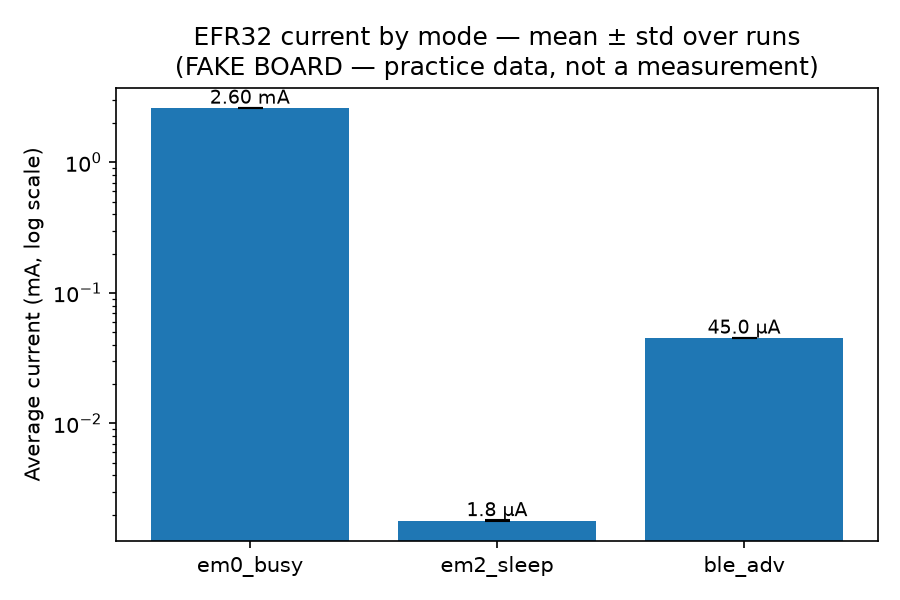

# EFR32 DV Harness — Level 1 (device control + power)

## What this is, in one breath
A laptop is plugged into a Silicon Labs board by USB. This Python program
loads firmware, resets the chip, measures how much current it draws, repeats
that several times, and writes a report with averages, spread and a chart.
Nobody touches the board while it runs.

## Status — read this first

The numbers this repo produces right now come from a **simulated** Simplicity
Commander (`tools/fake_commander.py`), not from a board. Hardware access is
pending a college MOU, so the harness was built and validated against a fake
device that emits the same output format as the real tool. Everything under
`docs/sample-run/` is illustrative: it shows that the measurement flow, the
statistics, the limit checks and the reporting work end to end. It is **not a
measurement of any physical device** and no number here should be quoted as one.

Switching to real hardware is one line in `config.yaml` (`commander: "commander"`)
plus real serial numbers and real `.s37` images. No test code changes.



*One run against the fake device: EM0 2.600 mA, EM2 1.80 uA, BLE advertising
45.0 uA, each a mean over five independent flash-reset-settle-measure cycles.
See [docs/sample-run/](docs/sample-run/).*

## Folder map
```
config.yaml                 <- your bench: serial numbers, firmware paths, pass/fail limits
dvharness/device.py         <- the "remote control" around Simplicity Commander
dvharness/stats.py          <- mean / std / min / max helper
tests/conftest.py           <- gives every test a ready-made board + results folder
tests/test_01_smoke.py      <- can we talk to the kit, flash it, reset it?
tests/test_02_power.py      <- Level 1: current in EM0 / EM2 / BLE-advertising
tools/fake_commander.py     <- a pretend board so you can practise without hardware
firmware/                   <- put your built .s37 files here
results/<timestamp>/        <- raw CSVs, per-run table, summary JSON, chart, JUnit XML
```

## Run it with NO hardware (practice mode) — works right now
```
pip install -r requirements.txt
python3 -m pytest
```
`config.yaml` points `commander:` at `tools/fake_commander.py`, which prints the
same shaped output as the real tool with made-up numbers.

## Switch to the REAL board (in the lab)
1. Install Simplicity Studio 6 → it brings Simplicity Commander. Add the folder
   containing `commander` (or `commander.exe`) to your PATH.
2. Plug the kit in. Find its serial: `commander adapter probe` (or read the sticker).
3. Edit `config.yaml`:
   - `commander: "commander"`
   - `boards.dut.serial: "<your J-Link serial>"`
4. Build the three firmware images in Studio/VS Code and copy the `.s37` files
   to `firmware/` with the names in `config.yaml`. Good starting examples in the SDK:
   a bare-metal blink/busy loop (EM0), an energy-mode / power-manager example
   that sits in EM2 with the RTC running, and "Bluetooth – SoC Empty" (advertising).
5. `python3 -m pytest` — same command, real numbers.

## If `adapter probe` says `AEM Supported : 0`
Your kit's on-board debugger has no current meter. Options: borrow a Wireless
Pro Kit mainboard (BRD4002A, has AEM), or use an external meter such as a
Nordic PPK2 (has a Python API). Then replace `Device.dump_current()` with a
call to that meter; the tests don't change.

## Rules of the harness (these are what a DV reviewer looks for)
- Every number is mean ± std over independent runs. Never one reading.
- Pass/fail limits live in config, not in code, and start loose until you have
  the datasheet open next to real data.
- Raw samples are always saved, so any summary can be re-checked later.
- A failing test prints WHICH mode, WHAT number, WHAT limit.
- Results folders are timestamped and never overwritten.

## What comes next (not in this folder yet)
- Level 2: `test_03_per_sweep.py` — two boards running RAILtest, packet error
  rate vs transmit power, plus a Wi-Fi interference comparison.
- Level 3: `test_04_ota_loop.py` — 100 over-the-air update cycles, interrupted
  update + rollback, overnight soak, flaky-test quarantine.
